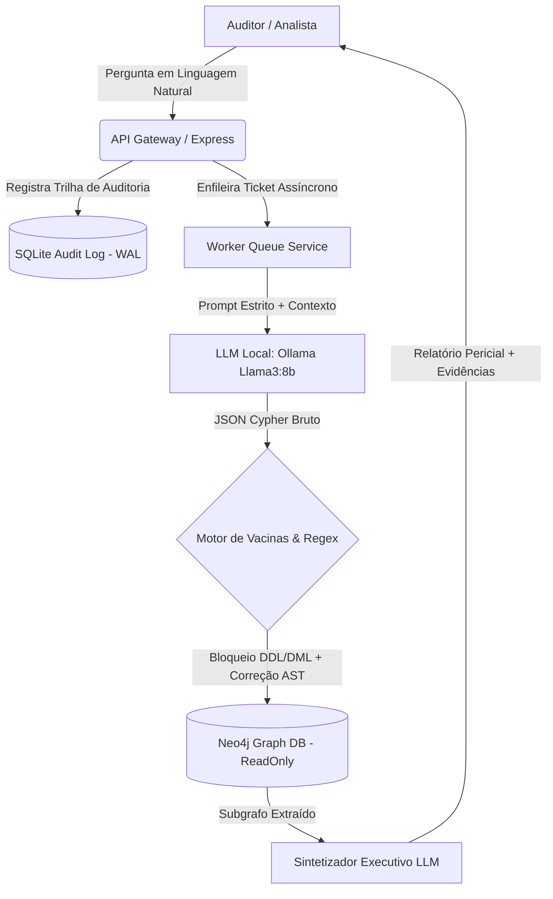

# 🛡️ OrbiTech GraphAudit Enterprise
> **Motor NL2Cypher Air-Gapped para Auditoria Corporativa, Compliance (KYP/AML) e Detecção de Fraudes em Cadeia de Suprimentos.**

---

## 🎯 O Problema de Negócio

Auditorias tradicionais em bancos de dados relacionais (SQL) falham ao tentar identificar **fraudes triangulares**, **empresas de fachada** e **conflitos de interesses ocultos** em múltiplos níveis (ex: um gerente de compras que aprova contratos para uma fornecedora cujo sócio secundário é seu parente ou compartilha conta bancária).

Por outro lado, o uso de LLMs em nuvem (OpenAI, Anthropic) para analisar dados corporativos esbarra em dois obstáculos críticos:
1. **Risco de Compliance e LGPD:** Dados financeiros, contratos e CPFs/CNPJs estratégicos não podem trafegar para APIs externas.
2. **Alucinação Sintática:** Modelos de linguagem frequentemente geram consultas `Cypher` inválidas, utilizam cláusulas destrutivas ou criam variáveis fantasmas que derrubam o banco de grafos.

---

## ⚙️ A Solução de Engenharia (Arquitetura)

O **GraphAudit Enterprise** resolve ambos os problemas através de uma arquitetura **100% On-Premise (Air-Gapped)** combinada com um **Compilador Determinístico de Sanitização Sintática**:

Diferenciais Técnicos de Nível Sênior:

🔒 Inferência Local (Zero Data Leakage): Integração direta com instância local do Ollama (llama3:8b, temperature: 0.0), garantindo que 100% dos dados sensíveis permaneçam no hardware da organização.

💉 Motor Proprietário de "Vacinas" Sintáticas (Deterministic Regex Parser): Camada intermediária em Node.js que intercepta a saída da IA antes da execução no banco, aplicando mais de 20 regras de correção determinística:

Coerção Financeira Automática: Conversão forçada de literais monetários em strings para toFloat() antes de agregações (SUM, ORDER BY).

Caçador de Variáveis Fantasmas (AST Validation): Varredura das variáveis declaradas nos nós MATCH contra a cláusula RETURN, prevenindo crashes de compilação no Neo4j.

Prevenção de Label Stacking Inválido: Desempilhamento automático de múltiplos labels mutuamente exclusivos gerados pela IA.

Escudo Read-Only & Anti-OOM: Bloqueio estrito contra comandos de mutação (CREATE, MERGE, DELETE, DROP, CALL) executado sob transações session.executeRead() com injeção forçada de LIMIT.

⏳ Processamento Assíncrono Resiliente: Arquitetura orientada a tickets com polling não-bloqueante e cache em memória (Map) para absorver consultas complexas de múltiplos saltos no grafo sem causar timeout na camada HTTP.

🖥️ Demonstração Interativa (Live Sandbox)
👉 **[Clique aqui para testar a Interface Executiva (Live Sandbox)](https://adrissoncunha.github.io/orbitech-graph-audit/)**

[GIF/Vídeo]

📂 Nota sobre Propriedade Intelectual
Este repositório é um Architecture Showcase. Para proteger a propriedade intelectual das regras heurísticas de compilação NL2Cypher e do motor de sanitização regex (llmService.js), o código completo do compilador é mantido em repositório privado e disponibilizado apenas durante demonstrações técnicas ao vivo ou processos seletivos avançados.
